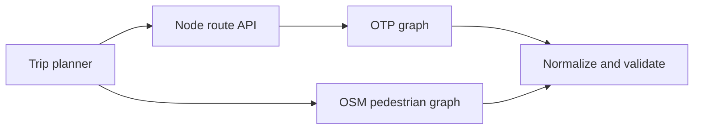

# Routing architecture

The browser owns search, the local pedestrian graph, user preferences, and display state. The same-origin Node service owns transit-provider selection. Its primary provider is a private OpenTripPlanner graph with dated feed provenance; it can consult a separately configured and validated OTP fallback after certain provider failures. The client can also use a configured local topology dataset as an explicitly limited secondary option. The production path does not require a client-side dataset.

Both paths represent routes as `RouteOption`: seconds, meters, ISO instants, longitude/latitude, a requested mode, actual modes, and leg-level provenance. `route-model.js` is the shared contract. `route-timeline.js` adds temporal invariants for dated rides, waiting, access, and transfers. A route can contain continuation segments for one onboard trip; different boardings on the same public line still count as transfers. The solver rejects a boarding that is earlier than the previous arrival plus the applicable access and minimum gap. `agency-time.js` converts NYC wall time and GTFS service-day data without using the browser's local clock settings.

The primary OTP adapter delegates search bounds, schedule calendars, and frequency-aware service to the mature engine while validating its results. It sends targeted GraphQL operations with variables, checks current route inventory, and preserves cases where provider data are present but unusable. The optional topology solver uses bounded candidates and nondominated labels across arrival, cost, transfers, onboard trip, and walking budget. It is not a whole-city schedule engine. A search that meets its bounds reports its limited evidence.

`server/request.js` validates request fields. `server/index.js` owns the HTTP lifecycle and route-attempt policy, with response helpers in `server/http.js`. OTP schema operations are in `server/otp-query.js`; `server/otp-provider.js` manages readiness and upstream calls; `server/otp-itinerary.js` maps the output; `server/transit-data.js` checks the manifest. Browser planning and stale-request ownership live in `route-service.js` and `route-session.js`. Map setup/render data, access policy, profile needs, weather, and UI helpers have separate modules. `app.js` still coordinates the main screen and navigation integration.

`accessibility.js` separates persistent conditions, such as a sustained grade, from per-event conditions, such as a single signalized crossing. Continuous cost scales with exposure. A strict curb requirement needs evidence for both curb endpoints. A mapped transit walk geometry does not itself establish wheelchair compatibility; projection gaps or missing pedestrian access are separately disclosed or refused under strict policy. Known negative evidence and unknown evidence use different decisions and UI statuses.

The service caps request size and concurrency, uses nested deadlines, propagates cancellation, and returns a structured error code instead of deriving a scheduling explanation from the selected mode. The app discards superseded requests and never treats failed realtime enrichment as the loss of a valid scheduled route. Trust boundaries are external map data, feed archives, upstream JSON, untrusted strings, and local storage. The web client writes provider strings as text or escapes interpolated content. Set the reverse proxy's TLS, rate limiting, and log policy to match your operating context.
